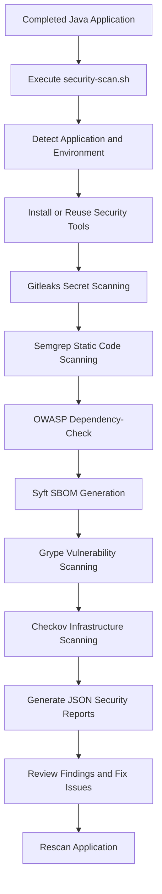

# Accidion DevSecOps Starter Kit

## Overview

Accidion is an automated security scanning toolkit designed
for developers who have completed their Java applications.

It automatically installs or reuses compatible security tools,
executes applicable security scans sequentially, and generates
detailed JSON security reports.

Developers do not need to manually configure each scanner.

## Supported Operating Systems

- Windows 10/11 using Git Bash
- Ubuntu and other supported Linux distributions
- macOS Intel and Apple Silicon
- Windows Subsystem for Linux (WSL)

Native macOS and standalone Linux end-to-end validation
is pending.

## Prerequisites

- Git
- Bash
- Approved internet access
- Writable home directory
- Python 3.10 or newer (Python 3.12 recommended)
- Compatible Java JDK
- Maven or Gradle, depending on the application
- Docker, only for optional container image scanning

The kit attempts to install missing compatible tools wherever
system permissions and organizational policies permit.

## Quick Start

### Step 1 - Complete Your Java Application

Develop and test your Java application using:

- IntelliJ IDEA
- Eclipse
- Visual Studio Code

Ensure the application builds successfully before scanning.

### Step 2 - Clone Accidion Repository

Open Git Bash on Windows or Bash on Linux/macOS.

Clone the security kit once:

```bash
mkdir -p "$HOME/devsecops"
git clone https://github.com/sumanthcloudm-sudo/Accidion-repo.git "$HOME/devsecops/Accidion-repo"
```

Keep the Accidion repository separate from your application.

Use an organization-approved repository revision.

### Step 3 - Navigate to Your Java Application

```bash
cd "$HOME/projects/my-java-app"
```

Replace the example path with your actual application path.

Windows Git Bash example:

```bash
cd "/c/Users/YOUR_USERNAME/projects/my-java-app"
```

### Step 4 - Execute One Security Scan Command

```bash
bash "$HOME/devsecops/Accidion-repo/security-scan.sh"
```

This single command automatically:

1. Detects the operating system and architecture.
2. Discovers Java application files and dependencies.
3. Checks required security tools.
4. Installs missing compatible tools where permitted.
5. Reuses existing compatible installations.
6. Executes applicable security scanners sequentially.
7. Displays security findings in the terminal.
8. Generates individual JSON security reports.
9. Generates a consolidated security summary.

## Security Scanning Tools

| Order | Security Tool | Purpose |
| --- | --- | --- |
| 1 | Gitleaks | Secret and credential scanning |
| 2 | Semgrep | Static application security testing |
| 3 | OWASP Dependency-Check | Java dependency vulnerability scanning |
| 4 | Syft | Software Bill of Materials generation |
| 5 | Grype | Package and optional container vulnerability scanning |
| 6 | Checkov | Infrastructure as Code security scanning |

Syft generates component inventory rather than vulnerability findings.

## Security Scanning Workflow



Individual scanners may be skipped or fail depending on
application contents, prerequisites, permissions and network access.

## Security Reports

Reports are generated outside the application directory.

Default report location:

```text
$HOME/.accidion/reports/<application-name>/<scan-directory>/
```

The terminal displays the exact report directory after execution.

| Report File | Description |
| --- | --- |
| security-summary.json | Consolidated security findings |
| gitleaks-report.json | Secret and credential findings |
| semgrep-report.json | Source code security findings |
| dependency-check-report.json | Java dependency vulnerabilities |
| syft-sbom.json | Software component inventory |
| grype-report.json | Package or container vulnerabilities |
| checkov-report.json | Infrastructure security findings |
| run.log | Execution and troubleshooting diagnostics |

Individual reports are generated when scanner output is available.

## Security Finding Details

The consolidated security summary includes available information:

- Issue number
- Issue name
- Security scanner name
- Vulnerability category
- Severity
- Affected filename
- Relative file path
- Start and end line numbers
- Issue description
- Root cause
- Security impact
- Recommended remediation
- CWE and CVE identifiers
- Affected dependency
- Installed version
- Fixed version
- Reference links

Unavailable information is reported as null or UNKNOWN.

## Example Security Finding

The following is an illustrative Semgrep finding:

```json
{
  "issue_number": 1,
  "issue_name": "Potential SQL Injection from Query Concatenation",
  "scanner_name": "Semgrep",
  "severity": "ERROR",
  "source_file": "src/main/java/com/example/App.java",
  "affected_filename": "App.java",
  "start_line": 25,
  "end_line": 25,
  "recommended_remediation": "Use parameterized queries with bound values."
}
```

Actual findings depend on the application and scanner results.

## Fix Security Issues and Rescan

1. Open security-summary.json.
2. Identify the security issue.
3. Open the affected application file.
4. Navigate to the reported line number, when available.
5. Review and apply the recommended remediation.
6. Build and test the application.
7. Execute the security scan again.

```bash
bash "$HOME/devsecops/Accidion-repo/security-scan.sh"
```

Compare the latest findings with the previous scan.

## Optional Advanced Commands

These commands are optional and are not required
for normal developer scanning.

Preview application discovery without scanning:

```bash
bash "$HOME/devsecops/Accidion-repo/security-scan.sh" --dry-run
```

Install or verify scanners without scanning:

```bash
bash "$HOME/devsecops/Accidion-repo/security-scan.sh" --setup-only
```

Scan without kit-managed installation:

```bash
bash "$HOME/devsecops/Accidion-repo/security-scan.sh" --no-install
```

The --dry-run and --setup-only modes are mutually exclusive. The --no-install option can be combined with either mode.

## Optional Container Image Scanning

Scan an existing Docker image:

```bash
bash "$HOME/devsecops/Accidion-repo/security-scan.sh" --image my-app:latest
```

Build and scan a Docker image:

```bash
bash "$HOME/devsecops/Accidion-repo/security-scan.sh" --build-image
```

Docker must be running with approved access.

## Troubleshooting

| Problem | Recommended Action |
| --- | --- |
| Python unavailable | Install approved Python or contact IT |
| Java build failure | Check JDK, Maven or Gradle configuration |
| Scanner installation blocked | Contact IT for approved installation |
| Database download failure | Check network, proxy and firewall settings |
| Docker unavailable | Start the approved Docker service |
| Checkov skipped | Verify supported infrastructure files exist |
| Report generation failure | Check directory permissions |

The first scan may take longer because security tools,
application dependencies and vulnerability databases
may need to be downloaded.

Subsequent scans can reuse compatible tools and caches.

## Important Notes

- Run the security kit only against trusted applications.
- The kit does not bypass organizational security controls.
- The kit does not automatically modify application source code.
- Dependency findings may not contain source line numbers.
- Default Grype scanning uses the SBOM.
- Container image scanning requires explicit selection.
- Review failed and skipped scanners before accepting scan coverage.
- Successful execution does not mean zero vulnerabilities.
- Treat generated security reports as sensitive information.

## Enhanced Security Reporting

The toolkit provides enhanced dependency and inventory details when matching scanner evidence is available:

- Maven dependency tree collection during dependency resolution.
- Direct and transitive dependency identification.
- Parent dependency name and version, where a unique relationship can be established.
- Dependency chains and matching Maven declaration file and line numbers.
- Dependency-specific remediation guidance.
- Individual SBOM component details.
- Available tool installation and scanner execution durations, plus total scan duration.

Developers do not need to run a separate Maven dependency-tree command. These details depend on successful dependency resolution and available scanner evidence. Maven dependency-chain enrichment is not equivalent to runtime exploitability analysis; equivalent Gradle chain enrichment is not currently documented as implemented.

## Ubuntu Installation Notes

The launcher does not invoke sudo. Python 3.10+, matching virtual-environment support, Git and a compatible JDK may require administrator-approved installation. If prerequisites cannot be installed under the developer account, contact the authorized administrator. Fresh Ubuntu and external Java application end-to-end validation remain pending.

## Additional Documentation

- [Developer Guide](DEVELOPER-GUIDE.md)
- [Sample Security Reports](sample-reports/README.md)

## Developer Quick Reference

Clone once, navigate to your completed Java application,
and execute:

```bash
bash "$HOME/devsecops/Accidion-repo/security-scan.sh"
```

One scan command. Automatic tool setup where permitted.
Sequential security scanning. Detailed JSON findings.
